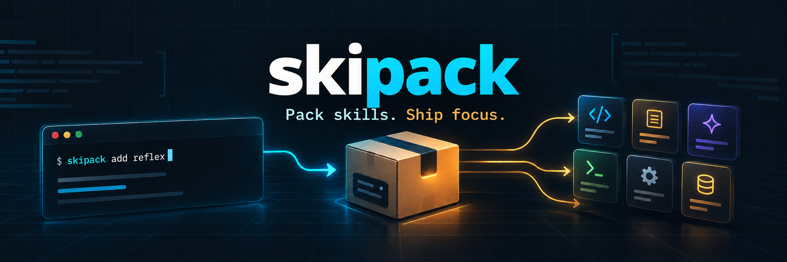

# skipack

Installez des groupes de skills pour vos agents de développement, directement
depuis GitHub.

`skipack` est une CLI Go multiplateforme qui copie des skills publics dans
`.agents/skills/`. Elle fonctionne sans Git, Node.js ou Python et ne lance
jamais les scripts téléchargés.

> **Statut :** préversion. Le format de configuration V1 est stable.

## Pourquoi skipack ?

- regrouper les skills utilisés ensemble sous un nom simple ;
- partager une même sélection entre plusieurs projets ;
- installer depuis un dépôt GitHub public sans cloner le dépôt entier ;
- mettre à jour uniquement les dossiers installés et suivis par `skipack` ;
- conserver les skills ajoutés manuellement sans jamais les modifier.

## Installation

### Binaires GitHub Releases

Chaque tag `v*` publie des binaires autonomes pour Windows, Linux et macOS,
accompagnés d’un fichier `SHA256SUMS`.

### Windows amd64 (PowerShell)

Téléchargez la dernière version de `skipack`, renommez l'exécutable en `skipack.exe` et installez-le dans `%USERPROFILE%\bin`. Le répertoire sera automatiquement ajouté au `PATH` utilisateur s'il n'y figure pas déjà.

```powershell
# Créer le répertoire d'installation
New-Item -ItemType Directory -Force "$HOME\bin" | Out-Null

# Télécharger la dernière release
Invoke-WebRequest `
    -Uri "https://github.com/CultureLinux/skipack/releases/download/v0.1.3/skipack-windows-amd64.exe" `
    -OutFile "$HOME\bin\skipack.exe"

# Ajouter le répertoire au PATH utilisateur si nécessaire
$userPath = [Environment]::GetEnvironmentVariable("Path", "User")

if (($userPath -split ';') -notcontains "$HOME\bin") {
    $newPath = (@($userPath, "$HOME\bin") | Where-Object { $_ }) -join ';'
    [Environment]::SetEnvironmentVariable("Path", $newPath, "User")
}

# Actualiser le PATH de la session courante
if (($env:PATH -split ';') -notcontains "$HOME\bin") {
    $env:PATH += ";$HOME\bin"
}

# Vérifier l'installation
skipack help
```

La commande `skipack` sera ensuite disponible depuis PowerShell, CMD et les terminaux VS Code nouvellement ouverts, sans droits administrateur.

Sous Linux amd64 :

```console
mkdir -p ~/.local/bin
curl -fL https://github.com/CultureLinux/skipack/releases/latest/download/skipack-linux-amd64 -o ~/.local/bin/skipack
chmod +x ~/.local/bin/skipack
skipack help
```

Remplacez `amd64` par `arm64` sur un système Linux ARM64. Les utilisateurs
macOS peuvent télécharger `skipack-darwin-amd64` ou
`skipack-darwin-arm64` selon leur processeur, puis appliquer `chmod +x`.

### Installation avec Go

Avec Go 1.23 ou plus récent :

```console
go install github.com/cyklodev/skipack/cmd/skipack@latest
```

Vous pouvez également construire le projet localement :

```console
git clone https://github.com/cyklodev/skipack.git
cd skipack
go build -o skipack ./cmd/skipack
```

## Démarrage rapide

Créez un fichier YAML encodé en UTF-8 :

```yaml
version: 1
groups:
  reflex:
    - source: owner/repository
      skill: investigate
    - source: owner/repository
      skill: caveman
  frontend:
    - source: https://github.com/owner/repository/tree/main/skills/frontend-design
```

Enregistrez la configuration, inspectez son contenu puis installez un groupe :

```console
skipack config set ./skipack.yaml
skipack list
skipack add reflex
# Ou installer tous les skills de tous les groupes
skipack add all
```

Les skills sont installés relativement au dossier courant :

```text
.agents/
├── skills/
│   ├── investigate/
│   │   └── SKILL.md
│   └── caveman/
│       └── SKILL.md
└── skipack-state.json
```

## Utiliser une configuration hébergée sur GitHub

1. Créez un fichier `skipack.yaml` dans un dépôt GitHub public.
2. Ajoutez-y vos groupes de skills, puis validez-le sur votre branche par
   défaut.
3. Ouvrez le fichier sur GitHub et copiez son URL `blob`, par exemple :

```text
https://github.com/owner/my-skipack-config/blob/main/skipack.yaml
```

4. Enregistrez cette URL une seule fois sur votre machine :

```console
skipack config set https://github.com/owner/my-skipack-config/blob/main/skipack.yaml
skipack config show
skipack list
```

`skipack` relit le fichier GitHub à chaque `list` ou `add` : les changements
validés dans le dépôt deviennent donc disponibles sans reconfigurer la CLI.
Les branches et tags contenant `/` sont résolus via l’API GitHub.

La source active est conservée dans le répertoire renvoyé par
`os.UserConfigDir` : `%AppData%\skipack` sous Windows,
`~/.config/skipack` sous Linux et `~/Library/Application Support/skipack` sous
macOS. Une configuration locale est également acceptée ; son chemin absolu est
alors mémorisé.

## Commandes

| Commande | Description |
| --- | --- |
| `skipack config set <source>` | Enregistre un fichier local ou une URL GitHub publique. |
| `skipack config show` | Affiche la source active. |
| `skipack list` | Liste les groupes et leurs skills. |
| `skipack add <groupe>` | Installe tous les skills du groupe. |
| `skipack add all` | Installe tous les skills de tous les groupes configurés. |
| `skipack delete <groupe>` | Supprime uniquement les skills suivis de ce groupe. |
| `skipack delete --all` | Supprime tous les skills suivis dans le projet. |
| `skipack update` | Rafraîchit le cache GitHub puis met à jour les skills suivis. |
| `skipack self-update` | Télécharge et installe la dernière release de skipack. |
| `skipack version` | Affiche la version du binaire installé. |
| `skipack help` | Affiche l’aide et des exemples. |

`add` ignore tout dossier déjà présent sans le modifier. `update` prépare et
valide tous les téléchargements avant de remplacer les versions existantes. Si
une ou plusieurs sources de skills sont inaccessibles, il les liste toutes,
renvoie un code d’erreur et conserve les versions déjà installées.
`delete` ne touche jamais aux dossiers qui ne sont pas suivis dans
`.agents/skipack-state.json`.

Pour changer complètement de contexte sans supprimer les skills ajoutés
manuellement :

```console
skipack delete --all
skipack add autre-contexte
```

## Cache GitHub

Pour limiter les appels à l’API GitHub et éviter les erreurs de rate limit
`403`, skipack met en cache les métadonnées, les refs, les configurations
distantes et les archives téléchargées. Plusieurs skills provenant du même
dépôt réutilisent donc la même archive, y compris lors d’exécutions séparées.

Le cache est stocké à côté du fichier de settings :

- Windows : `%AppData%\skipack\cache\`
- Linux : `~/.config/skipack/cache/`
- macOS : `~/Library/Application Support/skipack/cache/`

`list` et `add` privilégient le cache existant. La commande suivante force un
rafraîchissement réseau des ressources utiles, une seule fois par URL, puis
met à jour les skills suivis dans le projet :

```console
skipack update
```

Si GitHub refuse ou interrompt le rafraîchissement, l’ancien cache et les
skills déjà installés sont conservés.

## Mise à jour de skipack

La mise à jour des skills et celle du binaire sont séparées :

```console
skipack self-update
```

La commande télécharge le binaire correspondant au système et à l’architecture
courants depuis la dernière GitHub Release, puis vérifie sa somme SHA-256 avec
`SHA256SUMS` avant de le remplacer. Elle prend en charge Windows amd64, Linux
amd64/arm64 et macOS amd64/arm64. Sous Windows, le remplacement se termine juste
après la fermeture de la commande, car un exécutable en cours d’utilisation ne
peut pas être remplacé directement.

## Sources de skills

Une URL complète désigne directement un dossier :

```yaml
- source: https://github.com/owner/repository/tree/main/path/to/my-skill
```

Une référence courte recherche un skill dans quatre emplacements :

```yaml
- source: owner/repository
  skill: my-skill
```

Emplacements pris en charge :

1. `skills/my-skill`
2. `.agents/skills/my-skill`
3. `.claude/skills/my-skill`
4. `my-skill`

Si plusieurs emplacements existent, l’installation s’arrête avec une erreur
d’ambiguïté au lieu d’en choisir un arbitrairement.

## Sécurité

Les sources distantes sont limitées aux dépôts GitHub publics accessibles en
HTTPS. Lors d’une installation, `skipack` :

- refuse les redirections vers un hôte inattendu ;
- limite la taille des téléchargements et applique un délai maximal ;
- rejette les chemins absolus, traversées de répertoires, symlinks et entrées
  spéciales présents dans une archive ;
- exige un fichier `SKILL.md` à la racine du skill ;
- prépare les fichiers dans un dossier temporaire ;
- n’exécute aucun fichier du skill téléchargé.

Le contenu d’un skill reste du code non fiable : relisez toujours ses
instructions avant de l’utiliser avec un agent.

## Développement

```console
go test ./...
go vet ./...
go build ./cmd/skipack
```

Le projet normalise les fichiers texte en UTF-8 et leurs fins de ligne avec
`.editorconfig` et `.gitattributes` pour conserver un comportement cohérent
sous Windows, Linux et macOS.

## Publication d’une release

Le workflow GitHub Actions teste le projet sous Windows, Linux et macOS. Un tag
`v*` déclenche ensuite la compilation des cinq binaires et crée la release :

```console
git tag v0.1.0
git push origin v0.1.0
```

Les artefacts publiés couvrent Windows amd64, Linux amd64/arm64 et macOS
amd64/arm64.

Les dépôts privés, la recherche sur skills.sh, les interfaces graphiques et la
gestion des dépendances entre skills ne font pas partie de la V1.
